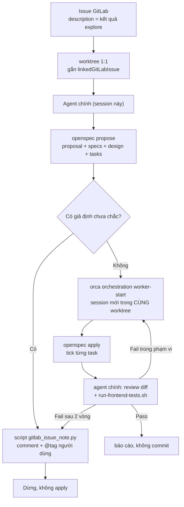

# IVR-Callflow-PBX

Monorepo của IVR Callflow PBX — nhiều service trong **một** git repo, mỗi service build bằng Dockerfile riêng.

## Cấu trúc

| Đường dẫn | Nội dung |
|---|---|
| `services/<service>/` | Mã nguồn từng service. Không có git riêng — chỉ repo gốc có `.git`. |
| `contracts/` | Contract dùng chung giữa các service, một bản duy nhất. Hiện có `flow-document.schema.json`. |
| `openspec/` | Nguồn sự thật về hành vi: `openspec/specs/` là hiện trạng, `openspec/changes/` là thay đổi đang làm. |
| `compose.yaml` | Môi trường local (dev + profile `test`). |
| `scripts/` | Công cụ vận hành ngoài build. Hiện có `gitlab_issue_intake.py` — kéo issue GitLab về thành worktree. |
| `AGENTS.md` | Quy tắc làm việc trong repo. |

## Service hiện có

| Service | Mô tả | Mã nguồn |
|---|---|---|
| `frontend` | SPA IVR Builder: React 19 + TypeScript + `@xyflow/react`, dựng bằng Vite. | `services/frontend/` |

## Build và test

Build image của service frontend (context là gốc repo, để `contracts/` đi cùng):

```bash
docker compose build frontend      # hoặc: docker build -f services/frontend/Dockerfile -t ivr-frontend .
```

Chạy test trong container (Vitest + Playwright):

```bash
docker compose --profile test run --rm frontend-test npm test
```

Chạy dev server:

```bash
docker compose up frontend         # http://localhost:5173
```

Chi tiết từng lệnh của frontend: `services/frontend/README.md`.

## Kéo issue GitLab thành worktree và xử lý

`scripts/gitlab_issue_intake.py` đọc issue `opened` của project trên GitLab, bỏ qua issue đã có
worktree gắn (hoặc đã xử lý trước đó), rồi tạo **đúng một** worktree gắn issue và khởi động
agent chính trong đó.

```bash
python3 scripts/gitlab_issue_intake.py --check     # exit 0 nếu còn issue mới, 1 nếu hết
python3 scripts/gitlab_issue_intake.py --take      # tạo worktree + agent cho 1 issue
python3 scripts/gitlab_issue_intake.py --take --dry-run   # xem trước, không tạo gì
```

Exit code: `0` có việc đã làm hoặc đang chờ, `1` không có issue mới, `2` thiếu cấu hình
(token/CLI), `3` GitLab API lỗi, `4` tạo worktree lỗi, `5` Orca CLI lỗi.

### Quy trình agent chính chạy

Mô tả issue là **toàn bộ nội dung một phiên `openspec explore`** đã chốt với người dùng; agent
chính không hỏi lại, chỉ chạy tiếp.



Prompt đầy đủ nằm ở `scripts/prompts/issue_main_agent.md`; `build_prompt()` chỉ thay
`{{iid}}`, `{{title}}`, `{{url}}`, `{{description}}`, `{{note_script}}`, `{{scripts_dir}}`.

Bước apply chạy qua `orca orchestration worker-start --worktree current --agent omp`, tức session
mới trong đúng worktree của issue — không phải worktree mới. Worker báo kết quả qua
`orca orchestration send` (outcome + files-modified), agent chính đọc lại bằng `worker-read`
và `task-list --run <run>` (report nằm ở `tasks[].result`).

Test chạy bằng `scripts/run-frontend-tests.sh`, không gọi `docker compose … npm test` trực tiếp:
container chạy bằng root nên `test-results/` rơi vào worktree thuộc root và chặn
`orca worktree rm`. Wrapper chạy đúng lệnh compose rồi dọn artifact bằng chính container.

Script phụ trợ:

- `scripts/gitlab_issue_note.py --iid N --body-file <file>` — comment blocker/thất bại lên issue,
  tự chèn `@<chủ token>` (đổi bằng `--mention` hoặc `INTAKE_MENTION`).
- `scripts/run-frontend-tests.sh` — chạy `npm test` trong container và dọn artifact root.

Worktree tạo với `--setup skip` (`INTAKE_SETUP=skip`): setup hook hiện tại của repo gọi
`openspec init`, một lệnh tương tác, nên nếu chạy hook thì agent kẹt ở prompt "Press Enter".
Đổi `INTAKE_SETUP=run` sau khi hook được viết lại theo dạng non-interactive
(`openspec init --tools none`).

### Token và đăng nhập

Token, theo thứ tự ưu tiên:

1. biến `GITLAB_TOKEN`;
2. file `~/.config/orca-gitlab/token` (`chmod 600`);
3. credential của `glab auth login` — `glab config get token --host gitlab19.mitek.vn`.

Đăng nhập một lần là đủ cho cả Orca và hai script:

```bash
glab auth login --hostname gitlab19.mitek.vn
git config --global credential."https://gitlab19.mitek.vn".helper \
  '!/home/namhee/.local/bin/glab auth git-credential'
```

Host/project/agent chỉnh qua biến môi trường `GITLAB_HOST`, `INTAKE_PROJECT_PATH`,
`INTAKE_REPO_NAME`, `INTAKE_AGENT`, `INTAKE_SETUP`, hoặc file `~/.config/orca-gitlab/config`
(dạng `KEY=VALUE`) — cần thiết khi chạy từ Orca automation vì precheck là tiến trình `cmd.exe`
không có biến của shell WSL.

Lịch chạy nằm ở Orca: automation **GitLab issue intake**, cron `*/5 * * * *`, precheck gọi
`--check` nên lượt không có issue mới chỉ ghi `skipped_precheck`. State (issue đã xử lý) ở
`~/.local/state/orca-gitlab-intake/state.json`; xoá file này để cho phép lấy lại issue.
